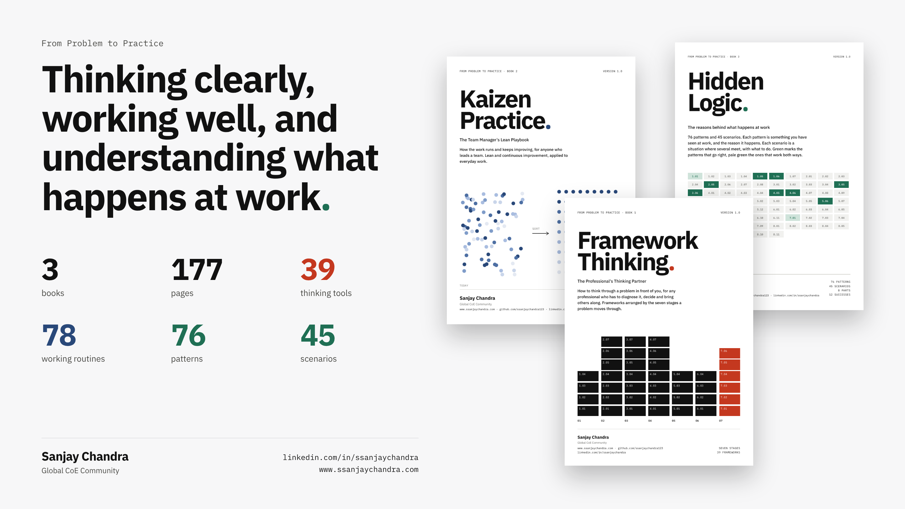
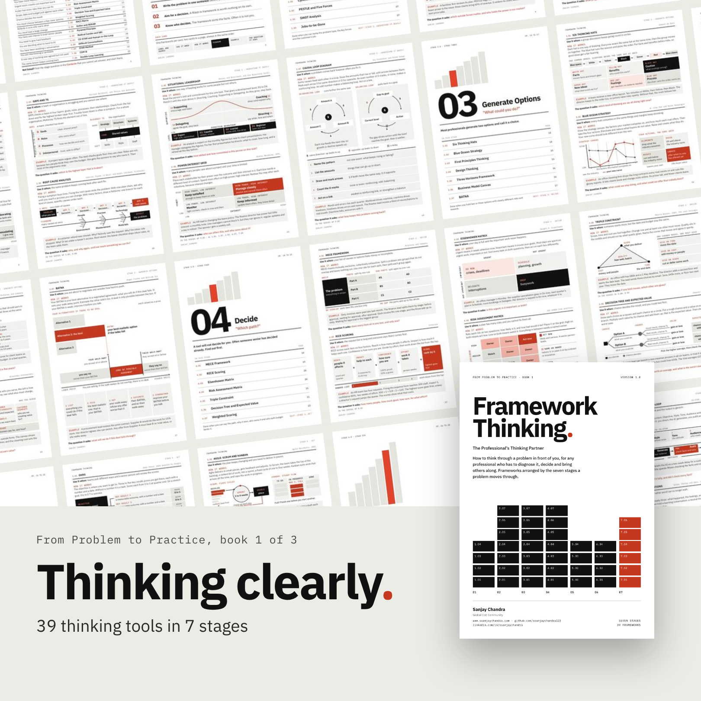
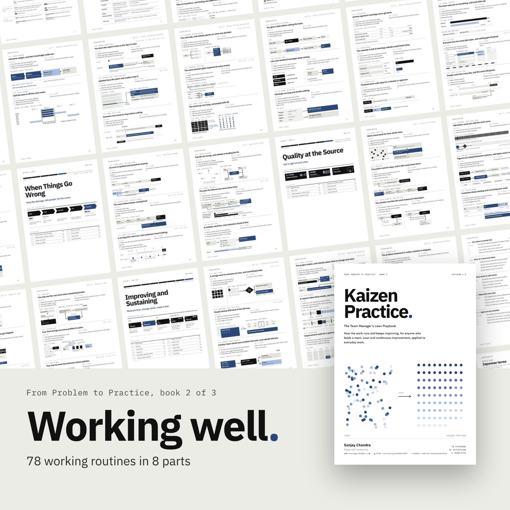
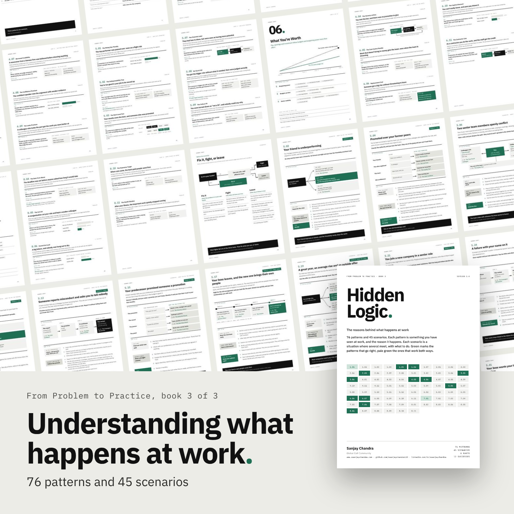

# From Problem to Practice

  

Three books on thinking clearly, working well, and understanding what happens at work.

Each one starts from a problem you have already seen at work, then gives you the tool, the routine or the reason behind it.

For anyone who works through problems, leads people, or is finding their way at work.

> **One home for the whole series.** All three books live here and updates will land here first.

---

## Framework Thinking

39 thinking tools in 7 stages, from naming the problem to making the change stick.

  

| Title | Download |
|---|---|
| Framework Thinking | [Download PDF](books/Framework%20Thinking%20by%20Sanjay%20Chandra.pdf) |

---

## Kaizen Practice

78 working routines in 8 parts. Each one is a problem you see at work and the routine that stops it coming back.

  

| Title | Download |
|---|---|
| Kaizen Practice | [Download PDF](books/Kaizen%20Practice%20by%20Sanjay%20Chandra.pdf) |

---

## Hidden Logic

76 patterns and 45 scenarios. What usually happens at work, why, and what to do.

  

| Title | Download |
|---|---|
| Hidden Logic | [Download PDF](books/Hidden%20Logic%20by%20Sanjay%20Chandra.pdf) |

---

Found a gap, or something that doesn't match what happens where you work? Open an issue.

---

Compiled with Claude by Anthropic and reviewed by Sanjay Chandra.

---

Sanjay Chandra, Global CoE Community.

---

[LinkedIn](https://www.linkedin.com/in/ssanjaychandra) · [Website](https://www.ssanjaychandra.com)
